# LUXE.TECH — Master Completion & Pre-Deployment Dossier

**Document Location:** [`LUXE_TECH_COMPLETION_REPORT.md`](file:///c:/Users/Lenovo/Downloads/FORCASTING%20WEBSITE/LUXE_TECH_COMPLETION_REPORT.md)  
**Workspace:** `C:\Users\Lenovo\Downloads\FORCASTING WEBSITE`  
**Date:** October 11, 2026  
**Status:** **READY FOR GATED OPERATOR DEPLOYMENT (PASS FOR READ-ONLY PRE-FLIGHT VERIFICATION)**  
**Auditors & Engineers:** Senior Full-Stack Engineer, Database Architect, Application Security Engineer, QA Lead  

---

## 1. Executive Summary & Verification Invariant

The LUXE.TECH Fashion Intelligence platform has completed its comprehensive offline maturation and hardening cycle. All application features, database models, security boundaries, storage workflows, and deployment checklists have been audited, tested, and validated.

### 1.1 Non-Negotiable Operational Invariants
* **Strictly Local & Offline Execution:** All audits, builds, pytest runs, and schema checks were performed locally. Zero remote database queries, zero cloud mutations, and zero modifications to `.env` occurred.
* **Preservation of Multi-Project Boundary:** LUXE.TECH operates inside its own isolated Supabase cloud boundary. The separate application hosted on the user's infrastructure remains untouched.
* **Credential Secrecy:** No passwords, service role keys, or JWT secrets were logged, printed, or exposed.
* **Zero Direct Remote SQL Execution:** Execution of SQL against the dedicated Supabase project is deferred exclusively to authorized human operators following the gated runbook.

### 1.2 Verification Matrix
| Dimension | Audit Target | Status | Verification Evidence |
|---|---|:---:|---|
| **Frontend Application** | React 19 + TypeScript + Vite | **PASSED** | Built with 0 errors via `npm run build` (1,897 modules, 285 kB gzip-compressed bundle). All 6 core pages, 3 modals, and search functional. |
| **Backend API Engine** | FastAPI + Local ML/CV + Optional Gemini | **PASSED** | 42/42 tests passing in pytest suite (38.33s runtime). Zero test failures. |
| **Database Schema** | 11 Tables, 113 Columns Parity | **PASSED** | 100% exact parity between SQLAlchemy ORM and `luxe_phase18_hardened_first_install.sql`. |
| **Fail-Fast Startup Guard** | Database Bootstrap in `database.py` | **PASSED** | Process aborts with `RuntimeError` if tables/columns are missing on PostgreSQL. Silent SQLite fallback and auto-creation are prevented. |
| **Runtime Role Isolation** | Dedicated `luxe_app_user` Role | **PASSED** | Role restricted to `LOGIN, NOSUPERUSER, NOCREATEDB, NOCREATEROLE, NOREPLICATION, NOBYPASSRLS`. Uniform DML granted, schema DDL revoked. |
| **Object Isolation** | Supabase Storage Policies | **PASSED** | Decoupled into `luxe_phase16_storage_setup_proposal.sql`. Public buckets (`trend-images`, `collections`) separate from private (`user-uploads`). Signed URLs enforced. |
| **API Security & Limits** | Sliding Window Rate Limiting & Auth | **PASSED** | Keyed on authenticated user ID or socket IP; spoofed proxy headers (`X-Forwarded-For`) strictly rejected. PBKDF2 password hashing with per-user salt. |

---

## 2. Full-Stack Application Status

### 2.1 Complete Frontend Navigation & Views
The LUXE.TECH user interface is fully implemented in [`frontend/src/App.tsx`](file:///c:/Users/Lenovo/Downloads/FORCASTING%20WEBSITE/frontend/src/App.tsx), styled in modern luxury-minimal aesthetic, and powered by [`frontend/src/services/api.ts`](file:///c:/Users/Lenovo/Downloads/FORCASTING%20WEBSITE/frontend/src/services/api.ts):

1. **Home (`/`):**
   * **Hero Section:** Full-bleed video backdrop with fallback, live telemetry badge, and navigation CTAs.
   * **Signal Feed Ticker:** Real-time directional metrics across Runway, Social, Retail, Search, and Cultural channels.
   * **Horizontal Intelligence Feed:** Interactive carousel displaying emerging trends with directional badges.
   * **16-Card Intelligence Grid:** High-level categorization routing seamlessly to Trend, Product, Retail, and Prophecy modules.
   * **Current Fashion Signal:** Snapshot of live consumer interest with cross-source agreement indicators.
   * **Platform Architecture Overview & Footer:** Complete brand navigation links and status indicators.

2. **Trend Detail & Explorer (`/trend`):**
   * **Category Filter Bar:** Dynamic filtering across all 16 fashion categories.
   * **Signal Breakdown:** Independent strength meters (0–100%) across Runway, Social, Retail, Search, and Culture.
   * **Visual DNA Matrix:** Structured inspection of extracted color codes (hex & proportions), materials, textures, silhouettes, and pattern types.
   * **Workspace Bookmark:** User-isolated "Save Trend" functionality persisted to `saved_trends` table.
   * **Cross-Source Agreement Score:** Quantitative measurement of signal consensus.

3. **Product Intelligence (`/product`):**
   * **Commercial Whitespace Opportunities:** Grid of market-ready silhouette recommendations.
   * **Design DNA Mapping:** Granular material, colorway, silhouette, and consumer demographic breakdowns.
   * **AI Concept Generation:** Trigger calling backend `/api/products/generate` via Gemini (or local structured heuristic fallback).
   * **Opportunity Scoring:** Commercial viability score (0–100%) indicating retail probability.

4. **Retail Telemetry (`/retail`):**
   * **Market Telemetry Radar:** Global perspective comparing observed retail signals.
   * **Regional Geography Panel:** Directional adoption metrics across major fashion hubs (US, EU, UK, JP).
   * **Category Adoption Matrix:** Demand index, retail penetration bars, and sell-through classification.
   * **Data Labeling:** Explicit data tags distinguishing verified signal datasets from synthetic demo layers.

5. **Statistical Forecasting Engine (`/forecast`):**
   * **Multi-Horizon Selector:** Toggle between 1-month, 3-month, and 6-month horizons.
   * **Four-Model Statistical Tournament:** Real-time walk-forward backtesting competing Moving Average, Simple Exponential Smoothing, Holt-Winters, and Linear Regression.
   * **Error Metric Ledger:** Granular reporting of MAE (Mean Absolute Error), RMSE (Root Mean Square Error), and MAPE (Mean Absolute Percentage Error).
   * **Dynamic Recalculation:** "Run Backtest & Recalculate" trigger calling `/api/forecast/{trend_id}`.
   * **Insufficient Data Safety Guard:** Explicitly flags when observations are $< 6$, preventing fabricated confidence.

6. **Future Prophecy (`/prophecy`):**
   * **5-Stage Evolutionary Trajectory Slider:** Interactive control dragging across `CURRENT`, `EMERGING`, `ACCELERATING`, `MAINSTREAM`, and `NEXT`.
   * **Multi-Dimensional Scenario Read:** Commercial opportunity narrative, market fatigue risk rating, and model confidence percentage.
   * **Supporting Evidence Ledger:** Chronological evidence points corroborating the evolutionary projection.
   * **Scenario Synthesis Trigger:** "Re-generate Scenarios" endpoint calling `/api/prophecy/{trend_id}`.

7. **Interactive Global Modals & Overlays:**
   * **Vision Lab Modal (`Camera` icon):** Drag-and-drop image upload supporting JPEG/PNG/WebP up to 10MB. Executes local OpenCV K-means color clustering (hex, RGB, percentage) alongside brightness, contrast, saturation, and edge density extraction, synthesized with Gemini interpretation.
   * **Search Overlay (`Search` icon / `/` shortcut):** Debounced real-time query searching across Trends, Products, Collections, Retail, and Prophecy with instant keyboard navigation.
   * **Authentication Modal (`Login` / `User` icon):** Dual login/register modal storing custom JWT tokens in local storage and populating authenticated analyst state across the platform.

---

## 3. Canonical Database Architecture (11 Tables & 113 Columns)

The canonical database schema is defined in [`supabase/proposals/luxe_phase18_hardened_first_install.sql`](file:///c:/Users/Lenovo/Downloads/FORCASTING%20WEBSITE/supabase/proposals/luxe_phase18_hardened_first_install.sql). It exhibits 100% field-by-field parity with SQLAlchemy models in [`backend/app/database.py`](file:///c:/Users/Lenovo/Downloads/FORCASTING%20WEBSITE/backend/app/database.py).

### 3.1 Reconciled Schema Inventory

```mermaid
erDiagram
    users ||--o{ saved_trends : saves
    trends ||--o{ saved_trends : "saved in"
    trends ||--o{ trend_signals : exhibits
    trends ||--|| trend_dna : contains
    trends ||--o{ images : references
    trends ||--o{ collections : groups
    trends ||--o{ products : derives
    trends ||--o{ retail_signals : monitors
    trends ||--o{ forecasts : projects
    trends ||--o{ prophecy : predicts

    users {
        varchar id PK
        varchar email UK
        varchar name
        varchar password_hash
        varchar role
        timestamptz created_at
        timestamptz updated_at
    }

    trends {
        varchar id PK
        varchar slug UK
        varchar name
        varchar category
        varchar season
        text description
        varchar image_url
        varchar status
        float confidence
        float momentum
        float velocity
        float acceleration
        varchar data_status
        timestamptz created_at
        timestamptz updated_at
    }

    trend_signals {
        varchar id PK
        varchar trend_id FK
        varchar source
        varchar signal_type
        float strength
        varchar direction
        timestamptz timestamp
        text metadata_json
        varchar data_status
    }

    trend_dna {
        varchar id PK
        varchar trend_id FK,UK
        text colors_json
        text materials_json
        text textures_json
        text silhouettes_json
        text patterns_json
        text visual_description
        text ai_interpretation
        varchar data_status
        timestamptz created_at
    }

    images {
        varchar id PK
        varchar trend_id FK
        varchar storage_path
        varchar public_url
        int width
        int height
        text dominant_colors_json
        float contrast
        float brightness
        float saturation
        float edge_density
        varchar data_status
        timestamptz created_at
    }

    collections {
        varchar id PK
        varchar trend_id FK
        varchar name
        text description
        text color_palette_json
        text materials_json
        text textures_json
        text silhouettes_json
        text patterns_json
        text product_opportunities_json
        varchar data_status
        timestamptz created_at
    }

    products {
        varchar id PK
        varchar trend_id FK
        varchar name
        varchar category
        text description
        varchar material
        varchar silhouette
        varchar color
        varchar target_consumer
        float opportunity_score
        text ai_reasoning
        varchar data_status
        timestamptz created_at
    }

    retail_signals {
        varchar id PK
        varchar trend_id FK
        varchar region
        varchar category
        float demand
        float growth
        text consumer_signal
        timestamptz timestamp
        varchar data_status
    }

    forecasts {
        varchar id PK
        varchar trend_id FK
        varchar model
        varchar horizon
        float forecast_value
        float confidence
        timestamptz training_start
        timestamptz training_end
        varchar data_status
        timestamptz created_at
    }

    prophecy {
        varchar id PK
        varchar trend_id FK
        varchar stage
        text forecast
        text evidence_json
        text opportunity
        text risk
        float confidence
        varchar data_status
        timestamptz created_at
    }

    saved_trends {
        varchar id PK
        varchar user_id FK
        varchar trend_id FK
        timestamptz created_at
    }
```


### 3.2 Schema Reconciliation Truth Table
| Table Name | Physical Column Count | Foreign Keys & Actions | Explicit Indexes & Constraints |
|---|:---:|---|---|
| `users` | 7 | None | `ix_users_email` (Unique) |
| `trends` | 15 | None | `ix_trends_slug` (Unique), `ix_trends_category` |
| `trend_signals` | 9 | `trend_id -> trends.id` (ON DELETE CASCADE) | `ix_trend_signals_trend_id` |
| `trend_dna` | 11 | `trend_id -> trends.id` (ON DELETE CASCADE) | `uq_trend_dna_trend_id` (Unique) |
| `images` | 13 | `trend_id -> trends.id` (ON DELETE SET NULL) | `ix_images_trend_id` |
| `collections` | 12 | `trend_id -> trends.id` (ON DELETE CASCADE) | `ix_collections_trend_id` |
| `products` | 13 | `trend_id -> trends.id` (ON DELETE SET NULL) | `ix_products_trend_id` |
| `retail_signals` | 9 | `trend_id -> trends.id` (ON DELETE SET NULL) | `ix_retail_signals_trend_id` |
| `forecasts` | 10 | `trend_id -> trends.id` (ON DELETE CASCADE) | `ix_forecasts_trend_id` |
| `prophecy` | 10 | `trend_id -> trends.id` (ON DELETE CASCADE) | `ix_prophecy_trend_id` |
| `saved_trends` | 4 | `user_id -> users.id` (ON DELETE CASCADE)<br>`trend_id -> trends.id` (ON DELETE CASCADE) | `uq_saved_trends_user_trend` (Unique), `ix_saved_trends_user_id`, `ix_saved_trends_trend_id` |
| **TOTALS** | **113 Columns** | **10 Foreign Key References** | **12 Indexes, 2 Unique Constraints** |

---

## 4. Security & Least-Privilege Confinement

### 4.1 Restricted Database Runtime Role: `luxe_app_user`
The application must never connect as the cloud superuser (`postgres`). It is configured to run under the restricted role `luxe_app_user`:
* **Attributes Enforced:** `LOGIN`, `NOSUPERUSER`, `NOCREATEDB`, `NOCREATEROLE`, `NOREPLICATION`, `NOBYPASSRLS`.
* **Privilege Scope:** Granted `USAGE` on schema `public` and `SELECT, INSERT, UPDATE, DELETE` strictly on the 11 application tables.
* **Revoked Scope:** Prohibited from `CREATE`, `DROP`, `ALTER` on schema or tables; cannot modify roles, permissions, or system catalogs.
* **RLS Confinement:** Because `NOBYPASSRLS` is enforced, PostgreSQL subjects every query executed by `luxe_app_user` to Row Level Security.
* **Application Tenant Isolation:** As audited in finding F-02, because runtime policies grant uniform DML to `luxe_app_user`, multi-user isolation is enforced strictly at the FastAPI application layer (e.g., verifying `SavedTrend.user_id == current_user["id"]`).

### 4.2 Storage Security & Bucket Separation
Defined in [`supabase/proposals/luxe_phase16_storage_setup_proposal.sql`](file:///c:/Users/Lenovo/Downloads/FORCASTING%20WEBSITE/supabase/proposals/luxe_phase16_storage_setup_proposal.sql):
* **Public Buckets (`trend-images`, `collections`):**
  * `public = true`.
  * Public read-only policy for `anon` and `authenticated` roles (`SELECT`).
  * Direct permanent CDN URLs permitted (`/storage/v1/object/public/...`).
* **Private Uploads Bucket (`user-uploads`):**
  * `public = false`.
  * **Zero public policies.** `anon` and `authenticated` roles have 0 access via PostgREST.
  * Direct public URLs are rejected by Supabase Storage.
  * Uploads and signed-URL creation occur strictly through backend service role key (`SUPABASE_SERVICE_ROLE_KEY`) with an expiring TTL (1 hour).

### 4.3 API Security & Sliding Window Rate Limiting
* **Rate Limiter:** Implemented in [`backend/app/utils/rate_limit.py`](file:///c:/Users/Lenovo/Downloads/FORCASTING%20WEBSITE/backend/app/utils/rate_limit.py).
* **Identifier Derivation:**
  * If a valid JWT Bearer token is provided, the key is extracted as `user:{user_id}`.
  * If unauthenticated, the key uses the direct socket connection host `ip:{request.client.host}`.
  * Client-spoofed forwarding headers (`X-Forwarded-For`) are strictly ignored by default.
* **Authentication Security:**
  * Passwords hashed with PBKDF2-HMAC-SHA256 with individual cryptographic salts and 600,000 iterations.
  * Custom JWT tokens signed with HMAC-SHA256 and subject to expiration validation.

---

## 5. Pre-Deployment Gated Execution Runbook

Deploying to the dedicated Supabase project must proceed through the following gated stages. If any verification check fails, **STOP IMMEDIATELY**.

```mermaid
flowchart TD
    G0["Gate 0: Pre-Flight Environment Audit & Read-Only Checks"]
    G1["Gate 1: Manual Role Provisioning (luxe_app_user)"]
    G2["Gate 2: Low-Level Connection Probe (SELECT 1 via Pooler)"]
    G3["Gate 3: Execute Canonical Migration (Phase 18 SQL)"]
    G4["Gate 4: Post-Migration Schema Verification"]
    G5["Gate 5: Decoupled Storage Provisioning (Phase 16 Storage SQL)"]
    G6["Gate 6: Backend Service Startup & Health Check"]

    G0 -->|Clean Schema & Proper Target| G1
    G1 -->|Role Attributes Confirmed| G2
    G2 -->|Port 6543 Probe Passes| G3
    G3 -->|11 Tables Created & RLS Active| G4
    G4 -->|Parity Verified (0 Missing)| G5
    G5 -->|Buckets Ready| G6
    G6 -->|/api/health 200 OK| Done["PRODUCTION LIVE & SERVING"]
```

### Gate 0: Pre-Flight Environment Audit & Read-Only Checks
1. Confirm Supabase project reference is the dedicated LUXE.TECH project.
2. In Supabase SQL Editor, verify that the `public` schema contains 0 application tables:
   ```sql
   SELECT table_name
   FROM information_schema.tables
   WHERE table_schema = 'public'
     AND table_type = 'BASE TABLE';
   ```
   * **Stop Condition:** If any tables exist, STOP. Do not overwrite or modify unknown schema.

### Gate 1: Manual Role Provisioning (`luxe_app_user`)
1. Generate a strong 32+ character random alphanumeric secret locally.
2. In Supabase SQL Editor (as administrative user), execute:
   ```sql
   CREATE ROLE luxe_app_user WITH
       LOGIN
       NOSUPERUSER
       NOCREATEDB
       NOCREATEROLE
       NOREPLICATION
       NOBYPASSRLS
       PASSWORD '<GENERATE_STRONG_RANDOM_SECRET>';
   ```
3. Verify role attributes:
   ```sql
   SELECT rolname, rolcanlogin, rolsuper, rolcreaterole, rolcreatedb, rolreplication, rolbypassrls
   FROM pg_roles
   WHERE rolname = 'luxe_app_user';
   ```
   * **Stop Condition:** `rolname` must be `luxe_app_user`, `rolcanlogin` must be `true`, and all other 5 privilege flags must be `false`.

### Gate 2: Low-Level Connection Probe (`SELECT 1`)
1. Assemble the connection URI using the transaction pooler (port 6543) or session pooler (port 5432):
   ```text
   postgresql://luxe_app_user.<project_ref>:<PASSWORD>@<pooler_host>:6543/postgres?sslmode=require
   ```
2. Execute a single read-only probe (`SELECT 1;`) from an isolated terminal.
   * **Stop Condition:** If connection fails or authentication is rejected, STOP. Do not proceed to migration execution until credentials and network paths resolve.

### Gate 3: Execute Canonical Migration (Phase 18 SQL)
1. Open [`supabase/proposals/luxe_phase18_hardened_first_install.sql`](file:///c:/Users/Lenovo/Downloads/FORCASTING%20WEBSITE/supabase/proposals/luxe_phase18_hardened_first_install.sql).
2. Copy the entire SQL content into the Supabase SQL Editor and execute.
3. The script executes within an explicit `BEGIN ... COMMIT` transaction block.
   * **Stop Condition:** If any statement errors, PostgreSQL rolls back the transaction automatically.

### Gate 4: Post-Migration Schema Verification
In Supabase SQL Editor, run:
```sql
SELECT
    c.relname AS table_name,
    c.relrowsecurity AS rls_enabled,
    c.relforcerowsecurity AS rls_forced
FROM pg_class c
JOIN pg_namespace n ON n.oid = c.relnamespace
WHERE n.nspname = 'public'
  AND c.relkind = 'r'
ORDER BY c.relname;
```
* **Required Output:** Exactly 11 rows (`collections`, `forecasts`, `images`, `products`, `prophecy`, `retail_signals`, `saved_trends`, `trend_dna`, `trend_signals`, `trends`, `users`). Every table must have `rls_enabled = true`.

### Gate 5: Decoupled Storage Provisioning (Phase 16 Storage SQL)
1. Open [`supabase/proposals/luxe_phase16_storage_setup_proposal.sql`](file:///c:/Users/Lenovo/Downloads/FORCASTING%20WEBSITE/supabase/proposals/luxe_phase16_storage_setup_proposal.sql).
2. Execute in Supabase SQL Editor to establish `trend-images` (public), `collections` (public), and `user-uploads` (private).
3. Verify buckets in Supabase Storage dashboard.

### Gate 6: Backend Service Startup & Live Verification
1. Set `.env` on the backend server:
   ```env
   ENVIRONMENT=production
   DATABASE_URL=postgresql://luxe_app_user.<project_ref>:<PASSWORD>@<pooler_host>:6543/postgres?sslmode=require
   ```
2. Start the FastAPI backend service.
3. Observe log output: `init_db()` will inspect the 11 tables and log:
   `"PostgreSQL schema verified; automatic demo seeding is disabled."`
4. Query `/api/health`: Verify HTTP 200 OK with:
   ```json
   {
     "status": "healthy",
     "database_backend": "postgresql",
     "database_connected": true,
     "supabase_postgres_connected": true
   }
   ```

---

## 6. Test Suite & Verification Results

### 6.1 Backend Automated Pytest Suite
* **Command:** `backend\venv\Scripts\pytest backend\tests`
* **Test Count:** 42 items collected
* **Pass Rate:** **100% (42 passed, 0 failed, 1 deprecation warning)**
* **Execution Duration:** 38.33 seconds
* **Test Modules Covered:**
  * `test_all_features.py`: Health checks, authentication flow, PBKDF2 salting, dashboard metrics, trend/category endpoints, signals, collections, products, retail telemetry, 4-model forecasting, prophecy scenarios, search engine, OpenCV computer vision & Gemini mock integration.
  * `test_api_security.py`: Anonymous rejection on protected routes, public read-only route availability, role-based access control, cross-user isolation on saved trends, upload file size boundaries, file extension/MIME validation, production CORS rejection of wildcards, sliding-window rate limiting, rejection of spoofed `X-Forwarded-For` headers, read-only GET guarantees, signed URL separation for private uploads, local storage traversal prevention.
  * `test_database_bootstrap.py`: Verifies `init_db()` fail-fast behavior; asserts that PostgreSQL rejects incomplete schemas and refuses to auto-create tables or run demo seeds.
  * `test_gemini_service.py`: Model configuration adherence, Part structure formatting, graceful fallback when API key is missing or invalid, byte-scoped caching, retail interpretation validation.
  * `test_supabase_storage.py`: Public URL generation for public buckets, signed URL generation with expiration for private buckets, prevention of public URLs on private buckets.

### 6.2 Frontend Production Build
* **Command:** `npm --prefix frontend run build` (`tsc -b && vite build`)
* **Modules Transformed:** 1,897 modules
* **Build Duration:** 5.05 seconds
* **Bundle Output:**
  * `dist/index.html`: 0.50 kB (gzip: 0.33 kB)
  * `dist/assets/index-DD2WpKQl.css`: 38.58 kB (gzip: 9.09 kB)
  * `dist/assets/index-BkZPSgVG.js`: 285.47 kB (gzip: 86.04 kB)
* **TypeScript Errors:** **0 errors**

### 6.3 Static Database & Schema Proposals Validation
* **Command:** `backend\venv\Scripts\python backend\scripts\validate_schema_proposal.py`
* **Output:** `Schema proposal parity: PASS (11 tables, 113 columns, 12 indexes, 11 RLS-enabled tables)`
* **Command:** `backend\venv\Scripts\python scratch\test_phase20_runtime_readiness.py`
* **Output:** `ALL OFFLINE CHECKS PASSED SUCCESSFULLY (Check 1: URL Parsing, Check 2: Privileged Role Detection, Check 3: Offline Schema Validation Guard, Check 4: Password URL-encoding roundtrip)`.

---

## 7. Rollback Limitations & Disaster Recovery Plan

As audited in finding F-06:
1. **Committed Initial Migration Cannot Be Rolled Back by Transaction:** Once an initial migration commits in PostgreSQL, it cannot be undone with a simple `ROLLBACK`.
2. **`DROP TABLE ... CASCADE` Is Prohibited Post-Launch:** Never execute drop statements against a live production database.
3. **Primary Recovery Mechanism:**
   * Before applying Gate 3, ensure Supabase automated backups are active.
   * If migration execution encounters unexpected errors prior to `COMMIT`, the SQL transaction block rolls back automatically.
   * If unexpected schema corruption occurs post-commit, restore from Point-in-Time Recovery (PITR) rather than attempting ad-hoc manual drops.

---

## 8. Final Sign-Off & Operator Readiness Verdict

| Audit Milestone | Sign-Off Status | Notes |
|---|:---:|---|
| Codebase Integrity & Bug Fixes | **APPROVED** | Frontend and backend fully aligned, error handling standardized. |
| Model & SQL Schema Parity | **APPROVED** | 11 tables, 113 columns verified with 0 discrepancies. |
| Security & Isolation Model | **APPROVED** | Role confinement designed, rate limiting active, bucket policies isolated. |
| Automated Test Verification | **APPROVED** | 42 backend tests passing, frontend builds cleanly with 0 TypeScript errors. |
| Pre-Deployment Gated Runbook | **APPROVED** | Gates 0 to 6 defined with explicit stop conditions. |
| **Overall Deployment Verdict** | **READY TO PROCEED** | **Offline preparation 100% complete. Operator may execute Gate 0.** |


