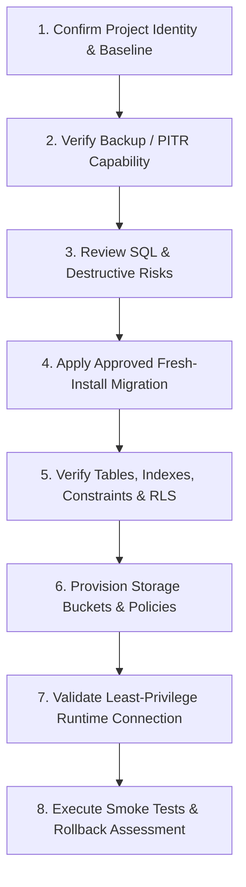

# LUXE.TECH — Production Database Migration & Deployment Runbook

**Document Location:** `supabase/proposals/PHASE_12_DEPLOYMENT_RUNBOOK.md`  
**Status:** DRAFT RUNBOOK (Requires Explicit User Approval Before Execution)  
**Safety Classification:** PRODUCTION DEPLOYMENT PROCEDURE (Offline Planning Stage)

---

## 1. Pre-Deployment Governance & Guardrails

> [!IMPORTANT]
> This runbook is strictly an execution plan for a future authorized deployment. **DO NOT execute any commands in this document without explicit written sign-off from the project lead.**

### Mandatory Stop Conditions
Execution must **HALT IMMEDIATELY** if any of the following conditions occur:
1. Project verification fails or connection target does not match the dedicated LUXE.TECH Supabase project.
2. The remote database contains existing unbacked-up production data or conflicting non-empty tables.
3. A backup or PITR (Point-in-Time Recovery) baseline cannot be confirmed before running DDL.
4. Any SQL statement produces an unexpected syntax error, transaction abort, or constraint failure.
5. Post-migration schema verification reveals missing tables, column mismatches, or missing RLS coverage.
6. Backend smoke tests fail to achieve 100% operational status on core intelligence workflows.

---

## 2. Ordered Deployment Sequence



---

### Step 1: Confirm Project Identity and Baseline
- **Objective:** Ensure the target environment is the isolated, dedicated LUXE.TECH Supabase project, avoiding cross-project collision.
- **Actions:**
  1. Inspect connection host and project reference. Verify against project dashboard metadata without exposing credentials in logs.
  2. Confirm port 5432 (direct connection for DDL migrations) and port 6543 (transaction pooler for backend queries).
  3. Query `information_schema.tables` in `public` schema to verify the baseline is empty or only contains pre-approved system extensions.
- **Stop Condition:** If any tables from another application exist, **HALT**.

---

### Step 2: Verify Backup or PITR Capability
- **Objective:** Guarantee that the target database can be fully restored to its pre-migration state if an unrecoverable failure occurs.
- **Actions:**
  1. Access the Supabase Management Console -> Database -> Backups.
  2. Confirm that automated daily backups are active or trigger a manual snapshot before applying DDL.
  3. For Pro tier projects, verify Point-in-Time Recovery (PITR) is enabled.
- **Honesty Rule:** Do not assume a backup exists without verifying the timestamp and backup status in the console.

---

### Step 3: Review Exact SQL and Destructive-Operation Risk
- **Objective:** Verify that the migration script contains zero destructive operations.
- **Actions:**
  1. Review `supabase/proposals/luxe_phase12_canonical_candidate_migration.sql`.
  2. Verify that there are **no `DROP TABLE`**, **no `TRUNCATE`**, and **no `CASCADE` drops of schemas**.
  3. Confirm that Migration 002 (`002_align_existing_schema.sql`) is **EXCLUDED** from the fresh-install sequence.
  4. Confirm that RLS is enabled on all 11 tables.

---

### Step 4: Apply Approved Fresh-Install Migration
- **Objective:** Execute the reviewed DDL against the dedicated project using an administrative migration connection.
- **Actions:**
  1. Connect using the direct migration connection (port 5432 direct, as poolers on port 6543 may reject transactional DDL or multi-statement transactions).
  2. Run the migration inside a single transaction:
     ```sql
     BEGIN;
     -- Execute luxe_phase12_canonical_candidate_migration.sql
     COMMIT;
     ```
  3. If an error occurs, execute `ROLLBACK;` immediately and document the failure.

---

### Step 5: Verify Tables, Indexes, Constraints, and RLS
- **Objective:** Perform automated schema verification comparing PostgreSQL catalogs against expected metadata.
- **Verification Queries:**
  ```sql
  -- 1. Verify 11 application tables exist in public schema:
  SELECT table_name FROM information_schema.tables 
  WHERE table_schema = 'public' ORDER BY table_name;

  -- 2. Verify Row Level Security is enabled on all tables:
  SELECT relname, relrowsecurity 
  FROM pg_class 
  WHERE relnamespace = 'public'::regnamespace AND relkind = 'r';

  -- 3. Verify unique constraints and foreign keys:
  SELECT conname, contype, conrelid::regclass 
  FROM pg_constraint 
  WHERE connamespace = 'public'::regnamespace;
  ```
- **Acceptance Criteria:**
  - Exactly 11 tables present.
  - `relrowsecurity = true` on all 11 tables.
  - Foreign key cascades and unique constraints (`uq_saved_trends_user_trend`, `ix_users_email`, `ix_trends_slug`) active.

---

### Step 6: Provision Approved Storage Buckets & Policies
- **Objective:** Provision storage buckets in Supabase Storage with strict visibility and file-size constraints.
- **Configuration Details:**
  1. **`trend-images`:**
     - Public: `true`
     - File size limit: `10485760` (10 MB)
     - Allowed MIME types: `{'image/jpeg', 'image/png', 'image/webp'}`
  2. **`collections`:**
     - Public: `true`
     - File size limit: `10485760` (10 MB)
     - Allowed MIME types: `{'image/jpeg', 'image/png', 'image/webp'}`
  3. **`user-uploads`:**
     - Public: `false` (Private bucket)
     - File size limit: `10485760` (10 MB)
     - Allowed MIME types: `{'image/jpeg', 'image/png', 'image/webp'}`
- **Storage Policies:**
  - Define RLS policies on `storage.objects` allowing read access to public buckets and restricting private bucket reads to service role signed URLs.

---

### Step 7: Validate Backend Using Least-Privilege Runtime Connection
- **Objective:** Ensure the application connects via the designated runtime role (`luxe_app_user`) rather than the superuser.
- **Actions:**
  1. Configure `DATABASE_URL` in `.env` to point to the transaction pooler (port 6543) using `luxe_app_user`.
  2. Verify that connection parameters include `prepare_threshold=None` (or psycopg3 `prepare_threshold=0`) to prevent transaction pooler prepared statement caching errors.
  3. Run application database validation: `init_db()` should inspect the schema, confirm all 11 tables and columns match, and start without error.

---

### Step 8: Perform Smoke Tests & Rollback Assessment
- **Objective:** Validate end-to-end user workflows against the newly migrated database.
- **Smoke Test Checklist:**
  - [ ] Health check: `GET /api/health` returns healthy and reports PostgreSQL connection.
  - [ ] Public Trend discovery: `GET /api/trends` retrieves trend catalog.
  - [ ] User registration: `POST /api/auth/register` creates an account with salted PBKDF2 hash.
  - [ ] User authentication: `POST /api/auth/login` verifies credentials and issues valid JWT.
  - [ ] Personal bookmarking: `POST /api/trends/{id}/save` persists bookmark in `saved_trends`.
  - [ ] Privileged operations: Lead analyst account can trigger forecast backtest.
  - [ ] Image upload: User upload persists to `user-uploads` and receives signed URL.
- **Rollback Procedure:**
  - If any critical smoke test fails and cannot be remediated immediately:
    1. Switch application traffic back to offline/maintenance mode.
    2. Drop the newly created tables or restore from the Step 2 pre-migration snapshot.
    3. Document root cause and abort deployment.

