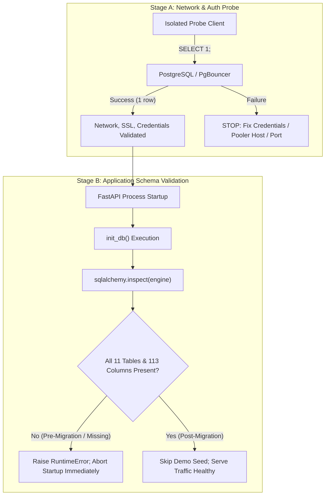
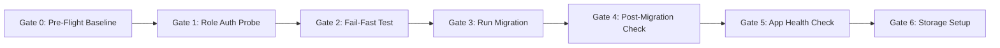

# LUXE.TECH — Phase 21: Pre-Deployment Safety Gate & Execution Protocol

**Document Location:** `supabase/proposals/PHASE_21_PREDEPLOYMENT_GATE.md`  
**Execution Mode:** STRICTLY LOCAL & OFFLINE (Zero remote database connections, zero SQL executions, zero credential exposure)  
**Date:** October 11, 2026  
**Auditor:** Senior Database & Application Security Migration Engineer  

---

## 1. Executive Summary & Verification Invariants

This Pre-Deployment Safety Gate establishes the definitive prerequisites, verification queries, deployment stages, and stop conditions required before executing the LUXE.TECH application schema on the dedicated Supabase project.

> [!IMPORTANT]
> **OFFLINE STATUS CONFIRMATION:**
> All validation, schema reconciliation, and security reviews conducted to date have occurred **strictly offline in the local repository**. No remote connections have been initiated, no remote catalog has been inspected, no cloud resources have been modified, and the remote database is **NOT DEPLOYED**. Production deployment is blocked until an authorized human operator executes the gated stages defined herein.

---

## 2. Canonical Migration Specification

### 2.1 The Single Canonical Migration Candidate
* **Target File:** [`supabase/proposals/luxe_phase18_hardened_first_install.sql`](file:///c:/Users/Lenovo/Downloads/FORCASTING%20WEBSITE/supabase/proposals/luxe_phase18_hardened_first_install.sql)
* **Preserved Historical Reference:** [`supabase/proposals/luxe_phase16_canonical_first_install.sql`](file:///c:/Users/Lenovo/Downloads/FORCASTING%20WEBSITE/supabase/proposals/luxe_phase16_canonical_first_install.sql) (Remains unchanged; not for direct execution due to placeholder password risk).
* **Scope:** 100% parity with SQLAlchemy `Base.metadata.tables` across 11 tables, 113 columns, 12 explicit indexes, 2 unique constraints, and 10 foreign keys.

### 2.2 The 11 Canonical Application Tables
| # | Table Name | SQLAlchemy Model Class | Physical Columns | Primary Key | Foreign Key (Cascade Action) |
|---|---|---|:---:|---|---|
| 1 | `public.users` | `User` | 7 | `id` (VARCHAR) | None |
| 2 | `public.trends` | `Trend` | 15 | `id` (VARCHAR) | None |
| 3 | `public.trend_signals` | `TrendSignal` | 9 | `id` (VARCHAR) | `trend_id -> trends.id` (CASCADE) |
| 4 | `public.trend_dna` | `TrendDNA` | 11 | `id` (VARCHAR) | `trend_id -> trends.id` (CASCADE) |
| 5 | `public.images` | `ImageRecord` | 13 | `id` (VARCHAR) | `trend_id -> trends.id` (SET NULL) |
| 6 | `public.collections` | `Collection` | 12 | `id` (VARCHAR) | `trend_id -> trends.id` (CASCADE) |
| 7 | `public.products` | `Product` | 13 | `id` (VARCHAR) | `trend_id -> trends.id` (SET NULL) |
| 8 | `public.retail_signals` | `RetailSignal` | 9 | `id` (VARCHAR) | `trend_id -> trends.id` (SET NULL) |
| 9 | `public.forecasts` | `Forecast` | 10 | `id` (VARCHAR) | `trend_id -> trends.id` (CASCADE) |
| 10 | `public.prophecy` | `Prophecy` | 10 | `id` (VARCHAR) | `trend_id -> trends.id` (CASCADE) |
| 11 | `public.saved_trends` | `SavedTrend` | 4 | `id` (VARCHAR) | `user_id -> users.id` (CASCADE)<br>`trend_id -> trends.id` (CASCADE) |
| — | **TOTALS** | **11 Models** | **113 Columns** | **11 PKs** | **10 Foreign Keys** |

---

## 3. Restricted Runtime Role Specification: `luxe_app_user`

The backend connects to PostgreSQL exclusively using the dedicated least-privilege role: **`luxe_app_user`**.

### 3.1 Mandatory Role Attributes
| Role Attribute | Required Value | Security Rationale |
|---|:---:|---|
| `LOGIN` (`rolcanlogin`) | `true` | Allows FastAPI backend authentication via connection URI. |
| `NOSUPERUSER` (`rolsuper`) | `false` | Prevents superuser privilege escalation and accidental RLS bypass. |
| `NOCREATEDB` (`rolcreatedb`) | `false` | Prohibits creating, altering, or dropping databases. |
| `NOREPLICATION` (`rolreplication`) | `false` | Prohibits access to replication slots and write-ahead log streaming. |
| `NOBYPASSRLS` (`rolbypassrls`) | `false` | **Critical:** Ensures the role is strictly bound by Row Level Security on all tables. |

### 3.2 Contrast With Administrative `postgres` Role
* On Supabase, the default `postgres` administrative user has `BYPASSRLS = true`, full table ownership, and DDL rights.
* Running FastAPI as `postgres` completely invalidates Row Level Security at the database layer.
* The application must **never** operate as `postgres` in staging or production.

---

## 4. Read-Only SQL Verification Checks (Post-Role Provisioning)

Prior to running the canonical migration, an authorized operator must execute these non-destructive read-only checks in the Supabase SQL Editor:

### 4.1 Check 1: Role Attribute Confinement Verification
```sql
SELECT
    rolname,
    rolcanlogin,
    rolsuper,
    rolcreaterole,
    rolcreatedb,
    rolreplication,
    rolbypassrls
FROM pg_roles
WHERE rolname = 'luxe_app_user';
```
* **Required Output:** Exactly 1 row.
  `rolname = 'luxe_app_user'`, `rolcanlogin = true`.
  `rolsuper`, `rolcreaterole`, `rolcreatedb`, `rolreplication`, `rolbypassrls` MUST ALL BE `false`.

### 4.2 Check 2: Schema Emptiness Baseline Check
```sql
SELECT table_name
FROM information_schema.tables
WHERE table_schema = 'public'
  AND table_type = 'BASE TABLE';
```
* **Required Output:** **0 rows**.
* Confirms schema `public` contains no existing application tables. If any tables exist, the initial install migration must NOT be executed.

### 4.3 Check 3: Default Privileges Sanitization Check
```sql
SELECT defaclnamespace::regnamespace AS schema_name, defaclacl
FROM pg_default_acl
WHERE defaclnamespace = 'public'::regnamespace;
```
* **Required Output:** Confirms no open default grants exist for `anon` or `authenticated`.

---

## 5. Separation: Connection Probe vs. Application Startup & Schema Validation

To prevent configuration errors from propagating into runtime failures, network and authentication verification is strictly decoupled from application startup:



### 5.1 Stage A: Low-Level Connection Probe (`SELECT 1`)
* **Objective:** Verify DNS resolution, port routing (5432 or 6543), TLS handshake, password authentication, and database connection grants without executing application code or touching application tables.
* **Command:** Minimal single-query probe:
  ```sql
  SELECT 1;
  ```
* **Behavior:** Proves `luxe_app_user` can authenticate to `postgres`.

### 5.2 Stage B: Application Startup & Schema Completeness Guard
* **Objective:** Ensure application cannot boot or serve traffic against an incomplete or un-migrated database.
* **Mechanism:** [`backend/app/database.py`](file:///c:/Users/Lenovo/Downloads/FORCASTING%20WEBSITE/backend/app/database.py#L270-L308) (`init_db()`) introspects the live database on startup.
* **Fail-Fast Behavior:**
  * If tables or columns are missing: Raises `RuntimeError("PostgreSQL schema is incomplete; no tables were created or changed...")` and halts the process immediately.
  * Refuses to auto-create tables on PostgreSQL (`Base.metadata.create_all` is never called on PostgreSQL).
  * Refuses to seed demo data on PostgreSQL (`seed_database` is called only on SQLite).

---

## 6. Gated Deployment Sequence & Explicit Stop Conditions

Execution must proceed through six distinct gates in exact sequential order. If any gate fails its verification condition, execution must **STOP IMMEDIATELY**.



### Gate 0: Pre-Flight Catalog Baseline
* **Action:** Operator logs into Supabase SQL Editor and executes Check 1 and Check 2 (Section 4).
* **STOP CONDITION:**
  - If schema `public` contains any existing tables, **STOP**.
  - If `luxe_app_user` already exists with `rolsuper = true` or `rolbypassrls = true`, **STOP**.
* **Success Condition:** `public` has 0 tables; role attributes confirmed.

### Gate 1: Network & Role Auth Probe (`SELECT 1`)
* **Action:** Test connectivity using `luxe_app_user` connection URI.
* **STOP CONDITION:**
  - If authentication fails, connection times out, or SSL handshake fails, **STOP**.
  - Note: On Supabase transaction pooler (port 6543), username must be formatted as `luxe_app_user.<project_ref>`.
* **Success Condition:** `SELECT 1;` returns integer `1`.

### Gate 2: Pre-Migration Application Fail-Fast Guard
* **Action:** Configure `.env` with `luxe_app_user` connection URI and run `backend\venv\Scripts\python.exe -c "import app.database; app.database.init_db()"`.
* **STOP CONDITION:**
  - If `init_db()` completes without error or creates tables, **STOP**.
* **Success Condition:** Correctly raises `RuntimeError: PostgreSQL schema is incomplete; no tables were created or changed...`.

### Gate 3: Canonical Migration Execution
* **Action:** Paste and execute [`luxe_phase18_hardened_first_install.sql`](file:///c:/Users/Lenovo/Downloads/FORCASTING%20WEBSITE/supabase/proposals/luxe_phase18_hardened_first_install.sql) into the Supabase SQL Editor.
* **STOP CONDITION:**
  - If the script fails, throws an error, or the prerequisite role check triggers (`RAISE EXCEPTION`), **STOP**.
  - The transaction executes `ROLLBACK;` automatically. Zero tables remain created. Do not attempt manual DDL patches.
* **Success Condition:** Query executes successfully with message `Success. No rows returned` (transaction committed).

### Gate 4: Post-Migration Schema & Security Introspection
* **Action:** Execute catalog introspection in Supabase SQL Editor:
  1. Confirm exactly 11 tables exist in `public`.
  2. Confirm 11/11 tables have `rowsecurity = true` in `pg_tables`.
  3. Confirm 11 runtime policies named `app_runtime_all` exist in `pg_policies`.
* **STOP CONDITION:**
  - If table count != 11, column count != 113, or any table lacks RLS, **STOP**.
* **Success Condition:** All 11 tables, 113 columns, and 11 RLS policies verified.

### Gate 5: Application Health & Route Verification
* **Action:** Boot FastAPI backend (`uvicorn app.main:app`) and query `GET /api/health`.
* **STOP CONDITION:**
  - If application crashes or `/api/health` returns HTTP 503, **STOP**. Inspect error logs.
* **Success Condition:** HTTP 200 returned with:
  ```json
  {
    "success": true,
    "data": {
      "status": "healthy",
      "database_backend": "postgresql",
      "database_connected": true,
      "supabase_postgres_configured": true,
      "supabase_postgres_connected": true
    }
  }
  ```

### Gate 6: Decoupled Storage Setup
* **Action:** Execute [`supabase/proposals/luxe_phase16_storage_setup_proposal.sql`](file:///c:/Users/Lenovo/Downloads/FORCASTING%20WEBSITE/supabase/proposals/luxe_phase16_storage_setup_proposal.sql).
* **STOP CONDITION:**
  - If bucket provisioning fails, application database remains unaffected. Inspect storage permissions.
* **Success Condition:** 3 buckets created (`trend-images`, `collections`, `user-uploads`).

---

## 7. Decoupled Storage Setup Invariant

The application schema migration and the storage bucket setup are strictly decoupled:
* **Table DDL ([`luxe_phase18_hardened_first_install.sql`](file:///c:/Users/Lenovo/Downloads/FORCASTING%20WEBSITE/supabase/proposals/luxe_phase18_hardened_first_install.sql)):**
  - Manages only relational tables, indexes, constraints, DML grants, and RLS policies in schema `public`.
  - Contains **zero** references to `storage.buckets` or `storage.objects`.
* **Storage Setup ([`luxe_phase16_storage_setup_proposal.sql`](file:///c:/Users/Lenovo/Downloads/FORCASTING%20WEBSITE/supabase/proposals/luxe_phase16_storage_setup_proposal.sql)):**
  - Manages storage bucket creation and storage CDN read policies in schema `storage`.
* **Benefit:** A failure, rollback, or modification in the storage layer cannot corrupt or roll back the core application database tables.

---

## 8. Rollback Governance & Irreversibility Limitations

Operators must understand the strict boundaries of database transactions and rollback mechanisms:

### 8.1 Transaction-Scoped Rollback (During Migration)
* The migration script opens with `BEGIN;` and concludes with `COMMIT;`.
* If any syntax error, foreign key violation, or prerequisite failure occurs **prior to `COMMIT;`**, PostgreSQL automatically triggers an engine-level `ROLLBACK;`.
* Result: **Zero tables remain created**. The database cluster returns to its pristine pre-migration state.

### 8.2 Committed State Irreversibility
* **A database transaction CANNOT undo an already committed migration.**
* Once `COMMIT;` completes, the transaction is closed.
* Issuing `ROLLBACK;` after a commit has no effect.

### 8.3 Post-Launch Permanent Prohibition: `DROP TABLE ... CASCADE`
* **`DROP TABLE ... CASCADE` is permanently prohibited post-launch.**
* Once users register and trend data is ingested, dropping tables causes **irreversible data loss**.
* **Post-Launch Disaster Recovery:** Must rely strictly on:
  1. Supabase Point-in-Time Recovery (PITR).
  2. Daily automated database snapshot restoration.
* **Post-Launch Schema Modifications:** Must always be executed via forward migrations (`ALTER TABLE ADD COLUMN`, etc.), never destructive teardowns.

---

## 9. Remaining Security Risks & Defense-in-Depth Analysis

### 9.1 Broad Runtime RLS Policies (`app_runtime_all`)
* **Risk Description:** Database policies on all 11 tables grant uniform DML access to `luxe_app_user` via `USING (true) WITH CHECK (true)`. PostgreSQL does **not** evaluate per-user row ownership filters at the SQL engine level.
* **Tenant Isolation Responsibility:** Row-level multi-tenant isolation rests **100% on the FastAPI application layer**:
  - `get_current_user` JWT dependency in [`backend/app/routers/auth.py`](file:///c:/Users/Lenovo/Downloads/FORCASTING%20WEBSITE/backend/app/routers/auth.py).
  - Explicit user ID filter in [`backend/app/routers/trends.py`](file:///c:/Users/Lenovo/Downloads/FORCASTING%20WEBSITE/backend/app/routers/trends.py#L180-L210): `SavedTrend.user_id == current_user["id"]`.
  - Namespaced storage file paths: `{user_id}/{uuid}_{filename}`.
* **Compensating Controls:** Automated security test suite ([`backend/tests/test_api_security.py`](file:///c:/Users/Lenovo/Downloads/FORCASTING%20WEBSITE/backend/tests/test_api_security.py)) enforces cross-user bookmark isolation.

### 9.2 PostgREST Public Surface Fail-Closed Discipline
* Public PostgREST access is blocked by `REVOKE ALL ON TABLE ... FROM anon, authenticated;`.
* All future migrations adding new tables must include explicit `REVOKE ALL` statements to prevent accidental public API exposure.

### 9.3 Cleartext Credential Confinement
* `DATABASE_URL` in `.env` stores credentials locally.
* Access to `.env` must remain restricted. It is excluded from version control via `.gitignore`.

---

## 10. Summary of Offline Validation Suite Results

All static analysis and offline regression tests passed 100%:

| Validation Check | Target / Tool | Result |
|---|---|:---:|
| **Candidate Parity & Security (9 Checks)** | `scratch/validate_phase18_sql.py` | **PASS (9/9 assertions)** |
| **Schema Reconciliation (11 Tables, 113 Cols)** | `scratch/reconcile_schemas.py` | **PASS (100% parity)** |
| **Query & Router Attribute Audit** | `scratch/inspect_queries.py` | **PASS (100% valid)** |
| **Runtime Role Readiness & Guard Simulation** | `scratch/test_phase20_runtime_readiness.py` | **PASS (4/4 scenarios)** |
| **Full Backend Pytest Security Suite** | `pytest backend/tests` | **PASS (42 passed in 32.04s)** |

---

## 11. Final Deployment Authorization Gate

```
================================================================================
LUXE.TECH PRE-DEPLOYMENT GATE STATUS: CONDITIONAL PASS (AWAITING HUMAN OPERATOR)
================================================================================
[x] Local schema proposals verified with 100% ORM parity.
[x] Role least-privilege specification verified (NOSUPERUSER, NOBYPASSRLS).
[x] Non-destructive catalog checks documented.
[x] Fail-fast application startup guards verified.
[x] Gated deployment sequence and stop conditions established.
[x] Decoupled storage setup verified.
[x] Rollback limitations and PITR recovery rules documented.
[x] Security risks and application tenant boundary documented.
[-] Operator execution in private Supabase SQL Editor (PENDING HUMAN GATE).
================================================================================
```

